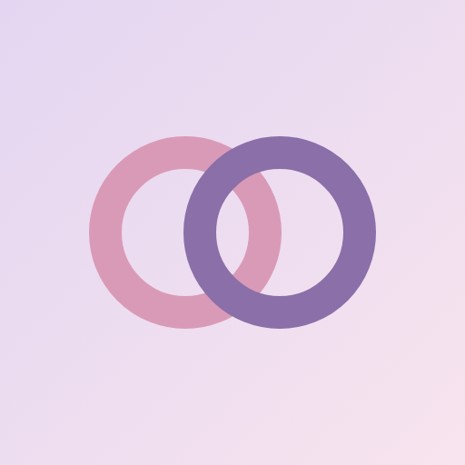
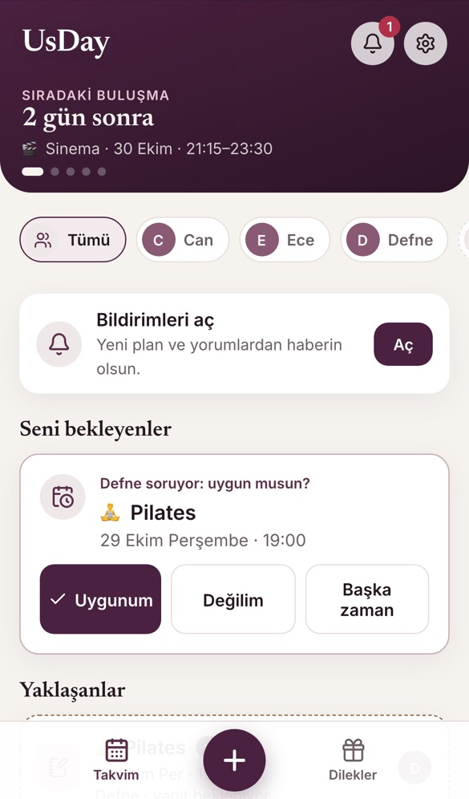
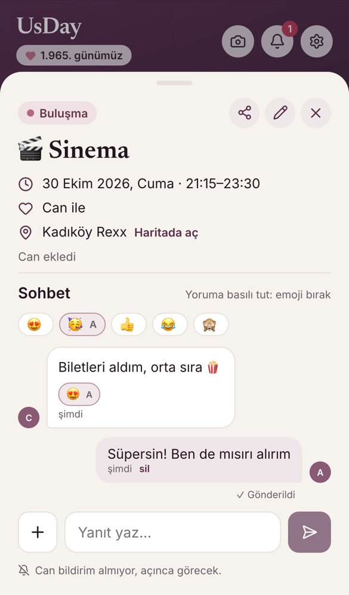
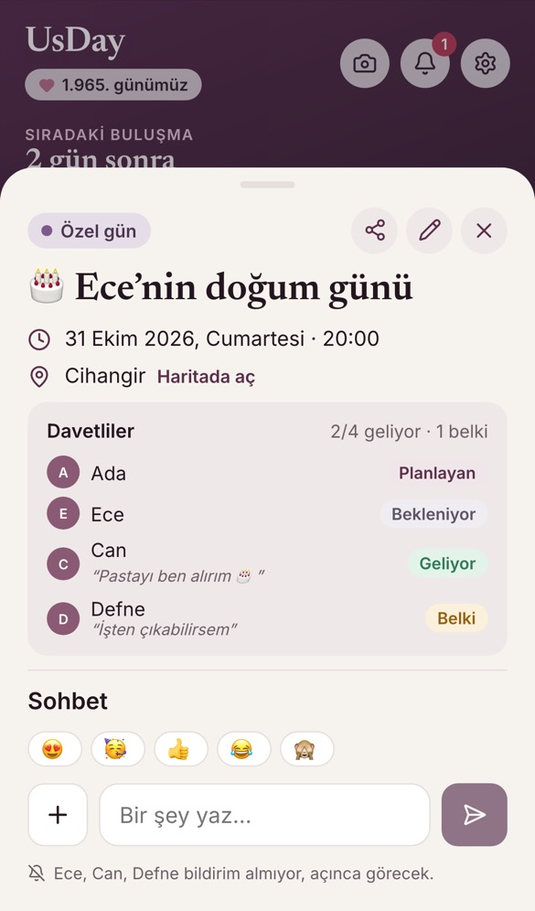
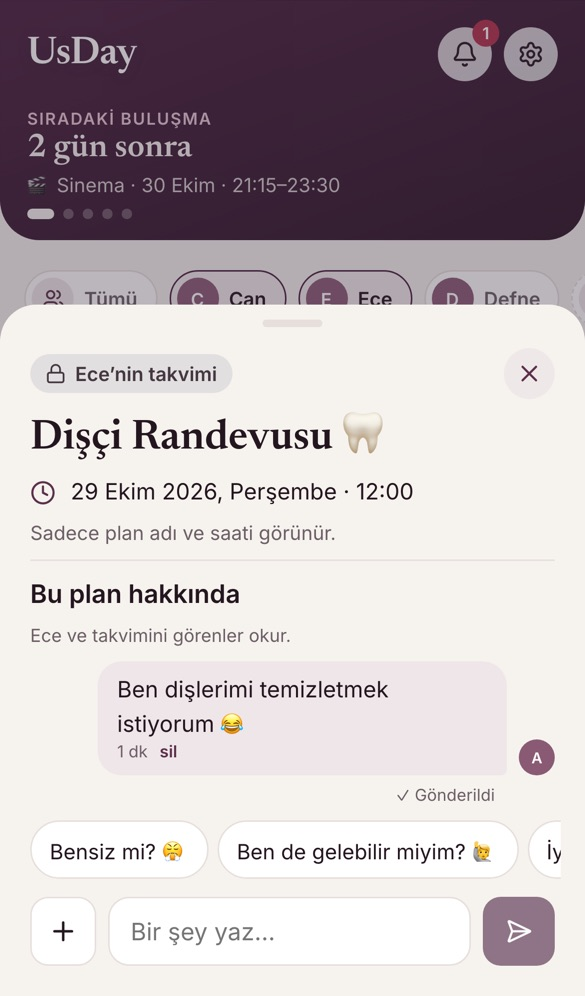
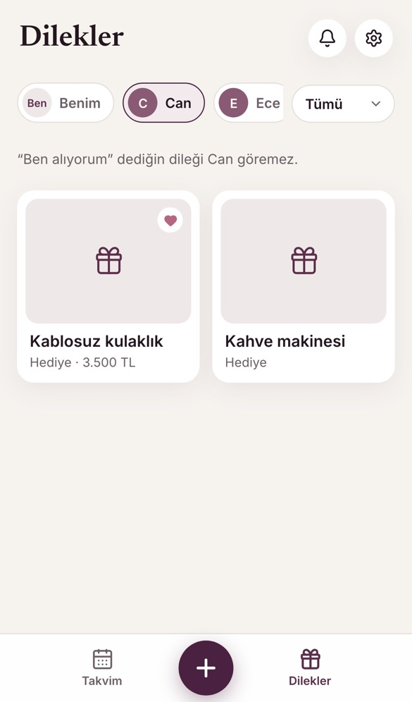
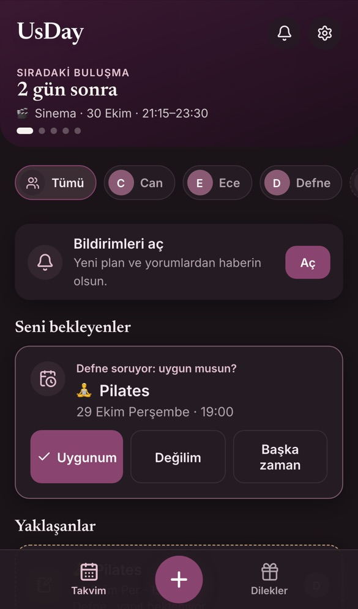
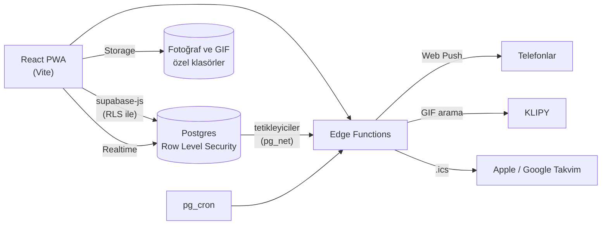

<p align="center">
  
</p>

<h1 align="center">UsDay</h1>

<p align="center">
  Sevdiklerinle ortak takvim: buluşmalar, planlar, sürprizler ve dilekler tek yerde.<br>
  <a href="https://usday.app"><b>usday.app</b></a>
</p>

<p align="center">
  
  
  
  
</p>

<p align="center">
  
  
  
</p>

UsDay; eşinle, kardeşinle, ailen ve arkadaşlarınla ayrı ayrı ortak takvim tutmanı sağlar. Her kişiyle kendi takviminiz olur, birinin planlarını diğeri görmez. İstersen hepsini tek ekranda birlikte görürsün. Sürpriz hazırlayabilir, toplu bir doğum günü organize edebilir, birbirinizin dilek listesinden hediye seçebilirsiniz.

> **In English:** UsDay is a shared-calendar PWA for couples, family and friends. Each connection has its own private calendar, with surprise plans that stay hidden until their reveal date, group plans with RSVPs, wish lists with secret “I’m getting this” claims, opt-in calendar sharing, and comments with photos, GIFs and emoji reactions. Privacy is enforced in the database with Postgres Row Level Security, not in the client.

## Özellikler

### Takvim ve planlar
- **Kişiye göre takvimler:** Her bağlantı (sevgili, kardeş, aile, arkadaş) ayrı bir ortak takvim. Üstteki kişi çubuğundan biri ya da birkaçı seçilir.
- **Ay ve hafta görünümü**, bugünün planları ve yaklaşanlar.
- **Plan teklifi:** “Önce ona soralım” denirse karşı taraf *Uygunum*, *Değilim* ya da *Başka zaman* der.
- **Tekrarlayan planlar**, konum (haritada aç), bitiş saati, not, bilet ve fotoğraf.
- **Çakışma uyarısı:** Seçilen saatte seninle ya da davet ettiğin kişilerle çakışan bir plan varsa söyler.
- **Gün sayacı ve yıldönümleri:** “1.965. günümüz”, otomatik yıldönümü günleri.
- **Telefon takvimine abonelik:** Apple ve Google Takvim’de kendiliğinden güncellenen .ics bağlantısı.

### Sürprizler
- Karşı taraf açılış gününe kadar yalnızca bir ipucu görür (“Cumartesi akşamını boş tut 😉”); biletler istenirse bulanık kalır.
- **Grup sürprizi:** Birkaç kişiyle hazırlanır, sürprizin sahibi hazırlık sohbetini göremez.

### Grup planları
- Birden fazla kişi seçilince grup planı olur; herkes *Katılıyorum*, *Belki*, *Başka zaman* ya da *Katılamıyorum* der, not ekleyebilir.
- Planlayan, önerilen başka bir zamana tek dokunuşla taşıyabilir.

### Sohbet
- Her planın altında yorumlar, **fotoğraf ve GIF** (uygulama içinden GIF arama).
- Yoruma **basılı tutarak emoji** bırakma, çift dokunuşla 😂; yorumu yazana bildirim gider.
- **“Gönderildi / Görüldü”** satırı.

### Takvim paylaşımı
- Takvimini seçtiğin kişiyle *dolu/boş* ya da *plan adlarıyla* paylaşırsın; yer, not ve kimlerle olduğun hiç görünmez.
- Paylaşılan takvimdeki planlar hakkında ortak sohbet (“Bensiz mi? 😤”).

### Dilekler
- Hediye, gezi ve deneyim dilekleri; “çok istiyorum” işareti.
- Başkasının dileğini **“ben alıyorum”** diye ayırma: dileğin sahibi görmez, diğerleri görür ya da sadece “biri alıyor” görür. Dilek tek dokunuşla sürpriz plana dönüşür.

### Bildirimler
- Web push (iPhone’da ana ekrana eklenince), uygulama içi bildirim kutusu, yaklaşan plan hatırlatmaları.
- Bildirime dokununca ilgili plan, sohbet ya da dilek açılır.

### Güvenlik ve topluluk
- Bağlantıyı kaldırma ve engelleme, şikayet etme, geri bildirim gönderme.
- Yönetici paneli: kullanıcılar, şikayetler, geri bildirimler, hesap askıya alma.
- Hesap ve tüm verileri kalıcı silme.

### Tasarım
- Mürdüm ve kırık beyaz renkler, tek tip çizgi simgeler, açık ve koyu tema.
- Metin kontrastı erişilebilirlik standardını (WCAG AA, 4,5:1) karşılar.
- Hikâyede paylaşmak için 1080×1920 plan kartları.

<p align="center">
  
  
  
</p>

## Mimari



| Edge Function | Görevi |
|---|---|
| `notify` | Yeni plan, yanıt, yorum, emoji ve dilek bildirimleri; yorumlarda veritabanı tetikler |
| `reminders` | Yaklaşan planlar ve yıldönümleri için zamanlanmış hatırlatmalar (pg_cron) |
| `ical` | Kişiye özel, sürprizleri gizleyen takvim aboneliği |
| `gifs` | GIF araması; anahtar sunucuda kalır, aramayı yapan kişi gizlenir |
| `remove-connection` | Bağlantıyı kaldırma ve engelleme, ilgili dosyaları temizleme |
| `delete-account` | Hesabı ve verileri kalıcı silme |
| `admin` | Yönetici paneli işlemleri |

## Gizlilik nasıl sağlanıyor?

Kimin neyi göreceğine istemci değil **veritabanı** karar verir:

- **Row Level Security:** Her tablo, kişinin yalnızca kendi bağlantılarının verisini okumasına izin verir.
- **Sürprizler:** Açılış gününe kadar sürprizin ayrıntıları ve bulanık seçilen fotoğraflar karşı tarafın cihazına hiç gönderilmez. Karşı taraf yalnızca ipucunu ve tarihi alır.
- **Dosya klasörleri:** Plan sohbetindeki görseller, sohbeti okuyabilen kişiyle aynı kurala bağlı. Grup sürprizinin hedefi hazırlık görsellerini ne açabilir ne de listeleyebilir.
- **Paylaşılan takvim:** Yalnızca seçilen seviyedeki bilgi döner. Yer, not ve diğer kişiler hiçbir zaman dönmez.
- **Dilek ayırmaları:** Dileğin sahibine hiç gönderilmez; adını gizleyen kişinin adı diğerlerine de gitmez.

Şema ve kurallar: [`supabase/migrations`](supabase/migrations) (30 migration).

## Teknolojiler

**İstemci:** React 19, Vite, date-fns, Lucide simgeleri, PWA (service worker, Web Push, ana ekrana ekleme)
**Sunucu:** Supabase (Auth, Postgres + RLS, Storage, Realtime, Edge Functions / Deno, pg_cron, pg_net, Vault)
**Diğer:** Resend (e-posta), KLIPY (GIF)

## Proje yapısı

```
src/
  components/   Ekranlar ve parçalar (Home, EventDetail, EventForm, WishesView, …)
  lib/          Veri katmanı (api.js), bildirimler, tarih ve çakışma hesapları, simgeler
  index.css     Tasarım dili: renk, yazı ve boşluk değişkenleri, açık ve koyu tema
supabase/
  migrations/   Şema, RLS kuralları, fonksiyonlar ve tetikleyiciler
  functions/    Edge Functions
public/         İkonlar, service worker, gizlilik ve kullanım koşulları sayfaları
```

## Kendi bilgisayarında çalıştırma

1. Bir Supabase projesi aç, `supabase/migrations` içindeki dosyaları sırayla uygula.
2. `.env.local` dosyası oluştur:

   ```
   VITE_SUPABASE_URL=...
   VITE_SUPABASE_PUBLISHABLE_KEY=...
   VITE_VAPID_PUBLIC_KEY=...
   ```

3. Edge Functions’ı yükle ve gizli anahtarlarını Supabase’e ekle: `VAPID_PUBLIC_KEY`, `VAPID_PRIVATE_KEY`, `VAPID_SUBJECT`, `CRON_SECRET`, `KLIPY_API_KEY`. Aynı `CRON_SECRET` değerini Vault’a `usday_cron_secret` adıyla da kaydet (veritabanı tetikleyicileri bununla bildirim gönderir). Şifre yenileme e-postaları için Supabase Auth’ta SMTP olarak Resend’i tanımla.
4. Çalıştır:

   ```bash
   npm install
   npm run dev
   ```

## Yol haritası

- [x] Giriş, davet koduyla bağlanma, canlı güncelleme
- [x] Sevgili, kardeş, aile ve arkadaş bağlantıları; kişi çubuğu
- [x] Sürpriz modu ve grup sürprizleri
- [x] Plan teklifleri, grup planları ve yanıtlar, çakışma uyarısı
- [x] Bildirimler, hatırlatmalar, bildirim kutusu
- [x] Yorumlar, fotoğraf ve GIF, emoji tepkileri, “Görüldü”
- [x] Dilek listeleri ve gizli “ben alıyorum”
- [x] Takvim paylaşımı
- [x] Engelleme, şikayet ve yönetici paneli
- [x] Telefon takvimine abonelik, hikâye kartları
- [x] Yeni tasarım dili ve koyu tema
- [ ] App Store ve Google Play sürümü
- [ ] Abonelik (bir bağlantıda iki kişiden birinin abone olması yeter)
